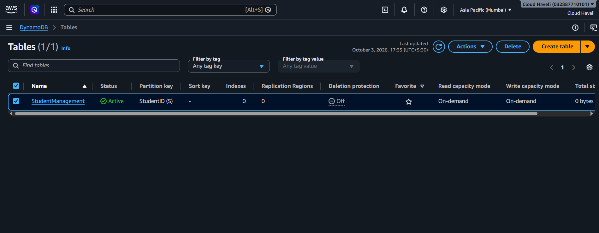
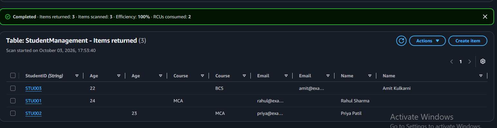
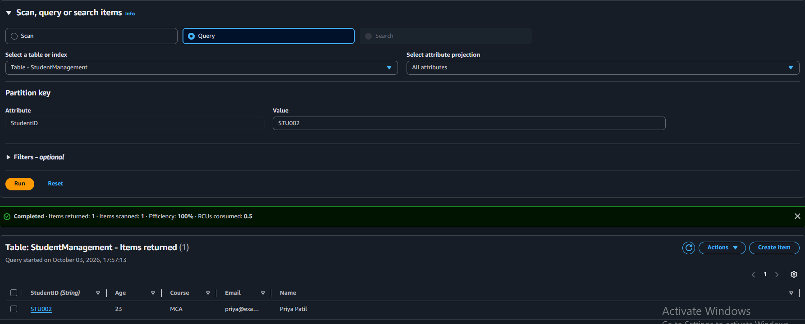
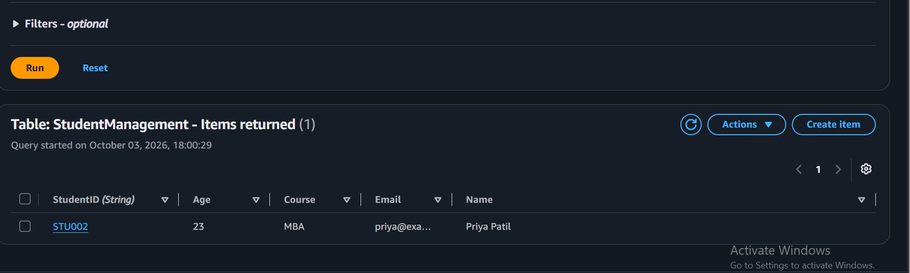
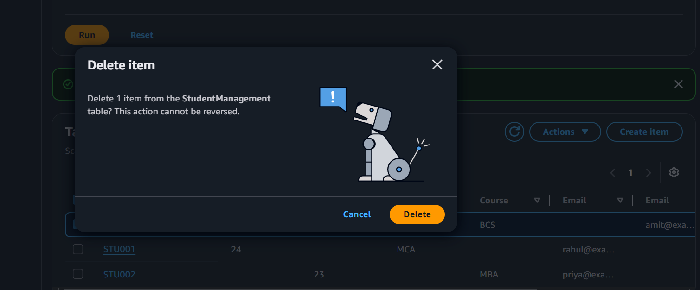

# AWS Assignment Set 5 — Question 3
## DynamoDB Student Management System

### 1. Project Objective

Create a student management system using Amazon DynamoDB and demonstrate the required database operations:

- Create a DynamoDB table
- Define an appropriate partition key
- Insert student records
- Retrieve a student record
- Update a selected record
- Delete a record
- Verify the final table state

This project implements **Question 3 of AWS Assignment Set 5**.

### 2. AWS Service Used

- **Amazon DynamoDB** — NoSQL managed database service

No EC2 instance is required for this project because the assignment requirement is specifically focused on DynamoDB operations.

### 3. Table Configuration

| Configuration | Value |
|---|---|
| Table name | `StudentManagement` |
| Partition key | `StudentID` |
| Partition key type | String (`S`) |
| Sort key | None |
| Read capacity mode | On-demand |
| Write capacity mode | On-demand |
| AWS Region | Asia Pacific (Mumbai) / `ap-south-1` |
| Initial table status | Active |

### 4. Why `StudentID` Was Selected as the Partition Key

`StudentID` was selected as the partition key because each student has a unique identifier such as:

```text
STU001
STU002
STU003
```

This provides a natural key for identifying and retrieving an individual student's record.

### 5. Student Records

The following three records were initially inserted:

| StudentID | Name | Course | Age | Email |
|---|---|---|---:|---|
| `STU001` | Rahul Sharma | MCA | 24 | rahul@example.com |
| `STU002` | Priya Patil | MCA | 23 | priya@example.com |
| `STU003` | Amit Kulkarni | BCS | 22 | amit@example.com |

### 6. DynamoDB Operations Performed

#### 6.1 Create Table

Created:

```text
StudentManagement
```

with:

```text
Partition Key = StudentID
Type = String
```

The table reached **Active** status.

#### 6.2 Insert Records

Three student records were inserted:

```text
STU001
STU002
STU003
```

The table view confirmed that 3 items were returned.

#### 6.3 Retrieve Record

A **Query** operation was performed using:

```text
StudentID = STU002
```

The operation returned the student:

```text
StudentID = STU002
Name      = Priya Patil
Age       = 23
Course    = MCA
Email     = priya@example.com
```

This demonstrates retrieving an individual item using the partition key.

#### 6.4 Update Record

The `STU002` record was updated:

```text
Course: MCA → MBA
```

The updated record was then visible as:

```text
StudentID = STU002
Name      = Priya Patil
Age       = 23
Course    = MBA
Email     = priya@example.com
```

#### 6.5 Delete Record

The `STU003` record was selected for deletion.

After deletion, the remaining records were:

```text
STU001
STU002
```

The delete confirmation screenshot documents the deletion action, while the table view visible behind the dialog shows the remaining records.

### 7. Final Table State

After completing all operations:

| StudentID | Name | Course | Age | Status |
|---|---|---|---:|---|
| `STU001` | Rahul Sharma | MCA | 24 | Present |
| `STU002` | Priya Patil | MBA | 23 | Updated |
| `STU003` | Amit Kulkarni | BCS | 22 | Deleted |

### 8. Evidence Screenshots

#### Screenshot 1 — DynamoDB Table Created



Shows the `StudentManagement` table in **Active** status with `StudentID` as the partition key.

#### Screenshot 2 — Student Records Inserted



Shows the three initially inserted student records: `STU001`, `STU002`, and `STU003`.

#### Screenshot 3 — Retrieve STU002 Using Query



Shows a DynamoDB **Query** using `StudentID = STU002` and the returned student record.

#### Screenshot 4 — Update STU002



Shows the updated `STU002` record with the course changed from `MCA` to `MBA`.

#### Screenshot 5 — Delete STU003



Shows the DynamoDB delete confirmation for one item. The table behind the dialog shows `STU001` and `STU002` remaining after the deletion workflow.

### 9. Operation Summary

```text
CREATE
  ↓
StudentManagement table
  ↓
INSERT
  ├── STU001
  ├── STU002
  └── STU003
  ↓
READ / QUERY
  └── Retrieve STU002
  ↓
UPDATE
  └── STU002: Course MCA → MBA
  ↓
DELETE
  └── STU003
  ↓
FINAL STATE
  ├── STU001
  └── STU002
```

### 10. Result

The DynamoDB Student Management System was successfully implemented. The project demonstrates table creation, partition-key design, record insertion, retrieval using a Query operation, record update, and record deletion.

### 11. Assignment Requirement Mapping

| Requirement | Status | Evidence |
|---|---|---|
| Create DynamoDB table | Completed | Screenshot 1 |
| Define partition key | Completed | `StudentID` |
| Insert student records | Completed | Screenshot 2 |
| Retrieve records | Completed | Screenshot 3 |
| Update selected record | Completed | Screenshot 4 |
| Delete a record | Completed | Screenshot 5 |
| Document operations | Completed | This README |

### 12. Project Status

**DynamoDB table:** Completed  
**Partition key:** `StudentID`  
**Insert:** Completed  
**Retrieve:** Completed  
**Update:** Completed  
**Delete:** Completed  
**Documentation:** Completed
